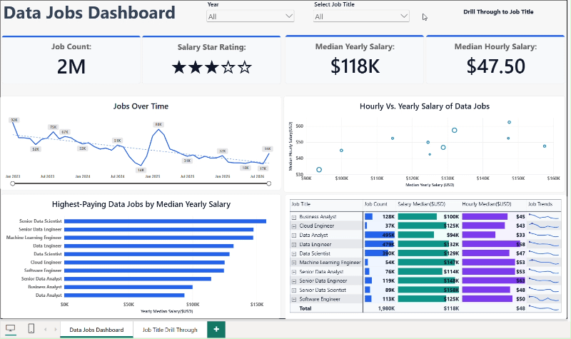
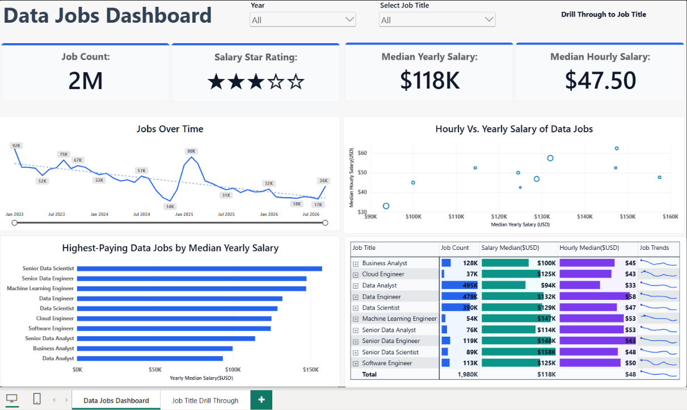
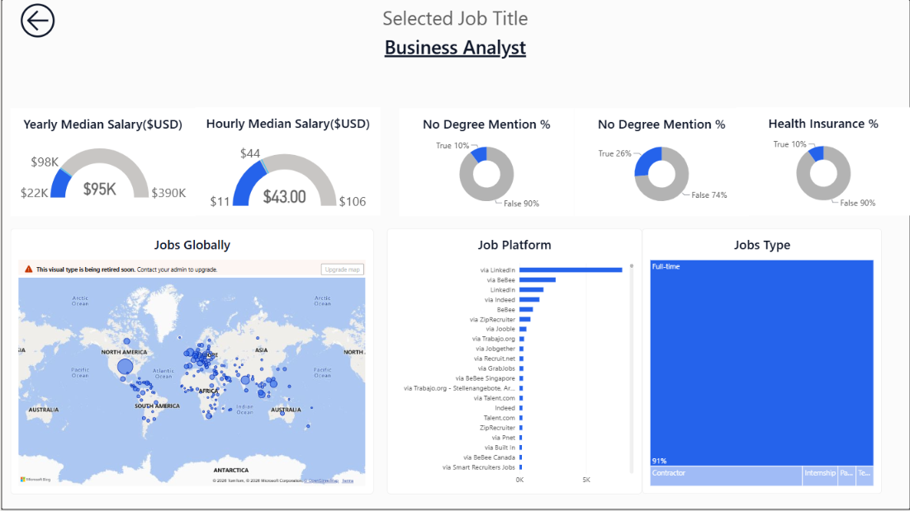

# Data Jobs Dashboard | Power BI

An interactive **Power BI job-market analytics dashboard** for exploring job demand, compensation, and characteristics of data-related roles. The report contains an overview page and a job-title detail page, connected through synchronized slicers and page navigation.

> **Navigation note:** Although the detail page is named **“Job Title Drill Through”** in the report, the primary workflow uses **page navigation + synced slicers**, not Power BI's native drill-through interaction. Selecting a job title in the overview dropdown filters the detail page; clicking a point in a visual is not required.

## Interactive Dashboard Demo



[View Interactive Dashboard on Power BI Service](https://app.powerbi.com/view?r=eyJrIjoiM2UxOTk5NTktMTUzZC00YWE5LTg3NmQtZmI3YTRhNjU5NDhiIiwidCI6ImMyNjhkYWI2LTBhOTUtNDZjYi1iZTYzLTUwZTgxODg2YWIxOCJ9)
## Dashboard preview

### Page 1 — Data Jobs Dashboard



The overview page provides a broad comparison of data-related jobs, with interactive filters for exploring job-market patterns.

**Key metrics**

- Job count
- Median yearly salary
- Median hourly salary
- Salary star rating

The displayed values depend on the current filters and the refreshed dataset, so they may change when a different year or job title is selected.

**Visuals and interactions**

- **Job Title dropdown slicer:** Filters the overview and, via slicer synchronization, the job-title detail page.
- **Year slicer:** Filters the dashboard by year, allowing users to explore job-market patterns across the available years.
- **Jobs Over Time line chart:** Displays monthly job-posting counts over time. The Year slicer can be used to explore the trend for different years.
- **Hourly vs. yearly salary scatter plot:** Compares salary measures across job titles.
- **Highest-paying data jobs bar chart:** Ranks job titles by median yearly salary.
- **Job-title comparison matrix:** Displays job count, median yearly salary, median hourly salary, and job-trend sparklines. Colour-coded data bars help compare measures.
- **Navigation button:** Opens the job-title detail page. A prompt instructs viewers to select a job title first.

### Page 2 — Job Title Drill Through (job-title detail page)

This page provides a closer look at the job title selected on Page 1.

#### Business Analyst Selected



**Dynamic heading:** Uses the selected job title; when there is no single job title in filter context, it displays **“No single job title selected.”**

**Visuals**

- **Median yearly salary gauge:** Shows the median yearly salary within the configured gauge range.
- **Median hourly salary gauge:** Shows the median hourly salary within the configured gauge range.
- **Three donut visuals:** Two are currently titled **“No Degree Mention %”** and one **“Health Insurance %”**; each shows the relative proportions of True and False values. The duplicate titles are preserved here as displayed in the report; their underlying fields should be verified before assigning distinct business meanings.
- **Jobs Globally map:** Plots the geographic distribution of job postings.
- **Job Platform bar chart:** Compares posting sources/platforms.
- **Jobs Type treemap:** Shows the breakdown by employment type, such as full-time, contract, and internship.
- **Back button:** Returns to the overview page.

**Example — Business Analyst selected**

The screenshot illustrates the detail page filtered to Business Analyst. KPI values and chart results depend on the active filters and current dataset, so they may differ after a data refresh.

## How to use the report

1. Open **Data Jobs Dashboard** (Page 1).
2. Use the **Year** slicer to choose the year or years you want to analyse.
3. Choose a job title from the **Select Job Title** dropdown.
4. Review the updated KPIs, charts, and comparison matrix.
5. Use the **Drill Through to Job Title** navigation button to open Page 2.
6. Explore salary gauges, donut breakdowns, global distribution, posting platforms, and job types for the selected role.
7. Use the back arrow to return to the overview.

If no single job title is selected, the detail page shows its fallback heading rather than a specific job title. Some other visuals may still display aggregated data; the fallback heading alone does not imply the entire page is blank.

## How the filtering and navigation work

The report uses **Power BI Sync slicers** to carry the job-title selection from Page 1 to Page 2. The Job Title slicer is visible on Page 1 and synchronized with Page 2. On Page 2, the slicer is hidden but remains synchronized, allowing the selected job-title filter to be applied without displaying a second slicer.

The **Year slicer** is available on the overview page to filter the time period being analysed. The job-title selection is synchronized with the detail page, so the relevant visuals on Page 2 are evaluated using the selected job-title filter (along with any other applicable filters).

When a user selects a job title on Page 1 and navigates to Page 2, Power BI applies the synchronized selection as part of the filter context. Relevant KPIs, charts, and other visuals are recalculated using the filtered data.

A DAX measure is used separately to display the selected job title dynamically in a Card visual:

```dax
Selected Job Title =
SELECTEDVALUE(
    job_postings_flat[job_title_short],
    "No single job title selected"
)
```

`SELECTEDVALUE()` returns the job title when exactly one distinct title is present in the current filter context. If no single title is selected (including when multiple titles are selected), it displays the alternate text.

> **Important:** The DAX measure does not transfer filters between pages. Sync slicers handles the cross-page filtering, while the measure reads the resulting filter context to display the selected title. Other visuals respond to the filter context independently, provided their fields and measures are connected to the relevant data model and their interactions are enabled.

Page navigation is handled through a Page navigation button rather than Power BI's native Drill-through action.

## Data

The underlying `data_jobs_flat.csv` file has been updated with job-posting records through **September 2026**. The report uses this refreshed data to explore job demand, salary patterns, and job characteristics across the available years. The Year slicer allows users to focus the overview analysis on a selected year or period.

## Tools and techniques

- **Power BI Desktop** — report development and interactive visualizations
- **DAX** — dynamic selected-job-title measure and report calculations
- **Slicers and Sync slicers** — year-based analysis and cross-page job-title filtering
- **Page navigation and buttons** — movement between overview and detail pages
- **Conditional formatting** — data bars in the comparison matrix
- **Sparklines, gauges, donut charts, scatter plot, map, line chart, bar charts, and treemap** — complementary views of the job market

## Repository structure

```text
Power_BI_Dashboards/
├── README.md
├── Data Jobs Dashboard.pbix
├── assets/
│   └── Data_Jobs_Dashboard_PowerBI.gif
└── screenshots/
    ├── Dashboard_Overview.png
    └── job-title-details-business-analyst.png
```


## Project purpose

This portfolio project demonstrates the ability to build a multi-page Power BI report that combines high-level job-market exploration with role-specific analysis, interactive year and job-title filtering, DAX-driven labels, and user-friendly page navigation.
